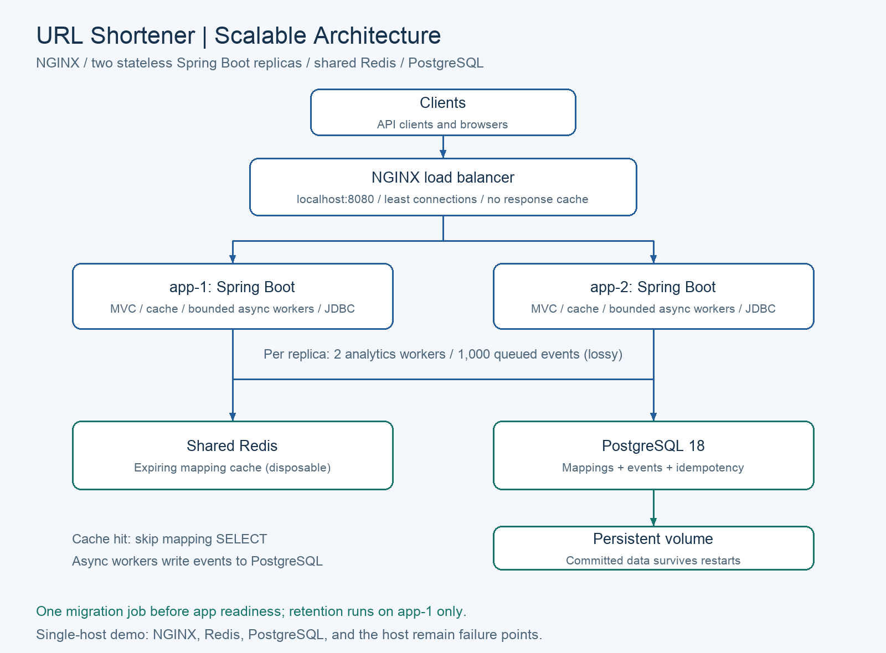
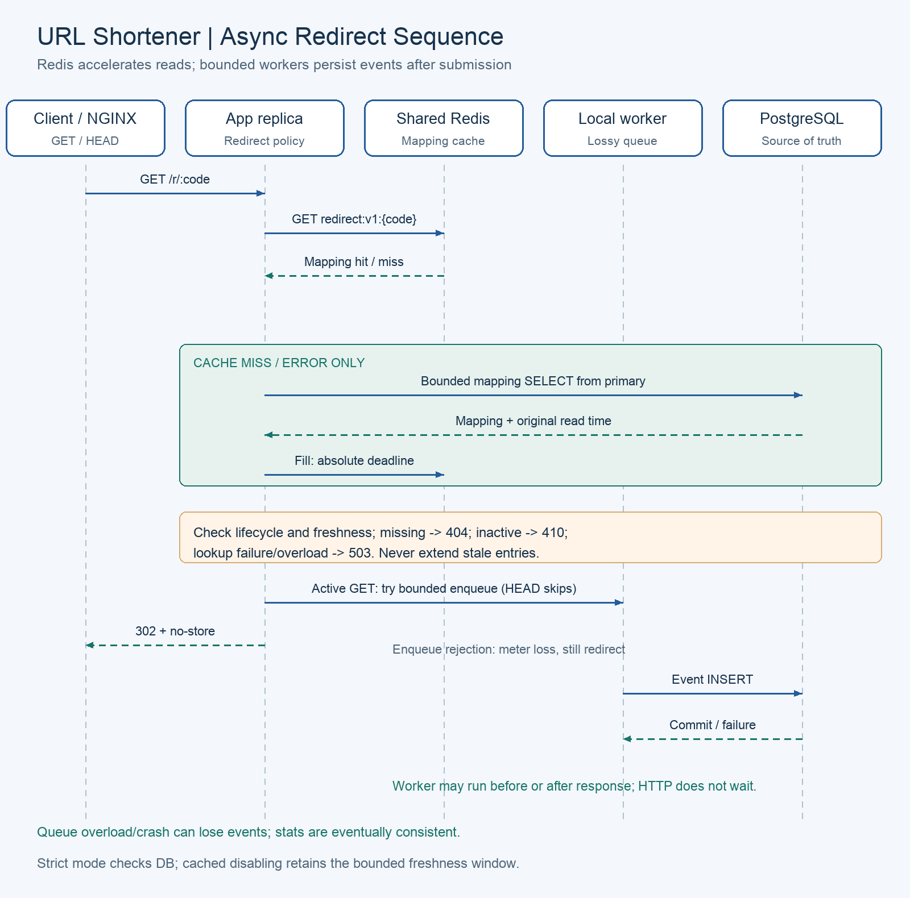

# URL Shortener Architecture

## 1. Purpose and design status

This document proposes the architecture for the interview assignment described in [problemStatement.md](problemStatement.md). The project must deliver a runnable Java/Spring Boot URL shortener with core APIs, analytics, and reliability features, while demonstrating engineer-led, AI-assisted implementation over 2-3 days.

The user has selected Java, Spring Boot, and PostgreSQL. The target deployment adds NGINX, two stateless application instances, and shared Redis for mapping caching, runnable locally with Docker Compose. PostgreSQL replaces the earlier in-memory H2 decision; see ADR-011 in [docs/decisions.md](decisions.md). Phases 0–6 are implemented: foundation, core APIs/idempotency, additive expiry, bounded asynchronous analytics and the Redis/NGINX two-replica deployment. V1–V3 remain unchanged in P5. The cache-disabled single-app topology is retained in `compose.baseline.yaml`; the default `compose.yaml` exposes only NGINX. Phase 5's tested cache values use original primary-read deadlines, with strict mode and bounded fallback/coalescing. See [validation results](validation-results.md), [setup](../README.md) and the implemented [P5 contract](openapi-phase5.yaml). Phase 6 adds real database-wait/recovery checks, patched dependency gates and a measured local k6 matrix. Phase 7 supplies the final handoff and clean-source replay; human final acceptance remains pending in [the review record](handoff/review.md). See [performance evidence](performance/README.md).

The assignment also evaluates requirement interpretation, decomposition, brownfield reasoning, validation, secure AI use, traceability, and engineer ownership. Those concerns are part of the engineering workflow described here; an AI service is not required in the running URL shortener.

## 2. Requirements and explicit assumptions

### Required by the assignment

- Build a working prototype with core APIs, analytics, and reliability features.
- Demonstrate greenfield, brownfield, and ambiguous scenarios, each with decomposition, execution, and validation.
- Produce maintainable code, API/schema definitions, unit/integration tests, architecture documentation, setup instructions, and an engineering summary.
- Use AI across implementation, debugging, refactoring, tests, documentation, and review preparation.
- Record generated, edited, and rejected output with rationale; apply quality gates and retain human oversight.
- Explain assumptions, limitations, risks, trade-offs, and defensible design decisions.

### Implemented defaults where the assignment is silent

| Topic | Prototype decision | Rationale or limitation |
| --- | --- | --- |
| Product surface | HTTP API, redirect endpoint, API documentation, and scripted demonstration | A graphical dashboard is optional and outside the critical path. |
| Deployment | NGINX, two Spring Boot instances, shared Redis, and PostgreSQL 18 | Five long-running containers plus one migration job, managed through Docker Compose. |
| Cache | Redis cache-aside for immutable link mappings | PostgreSQL remains authoritative; eviction never deletes durable links. |
| Disable consistency | Implemented cached mode allows up to 60 seconds of stale mapping reads, plus clock-skew tolerance | Strict mode bypasses mapping cache and preserves database-observed disabling. Product policy requires engineer review. |
| Persistence | PostgreSQL data in a named persistent volume | App/database restarts preserve committed data; removing the volume destroys it. |
| API access | All HTTP APIs are public | User-selected scope; no API credential or account model. |
| Public access | Anyone possessing a short link can resolve it | Short codes are public identifiers, not authorization secrets. |
| URL destinations | Absolute HTTP/HTTPS URLs only; no server-side destination fetch | Limits the accepted input and avoids adding crawler or preview behavior. |
| Aliases | Generated eight-character codes; custom aliases deferred | Reduces naming, reservation, and abuse-policy work. |
| Repeated destinations | Each creation produces a separate short link | Avoids ambiguous deduplication and ownership semantics. |
| Lifecycle | Optional expiration and irreversible disabling through the management API | Expiration provides a bounded brownfield enhancement. |
| Analytics | Total and UTC daily observed GET redirect requests | No unique-person claim, geolocation, or bot filtering. |
| Analytics delivery | Best-effort asynchronous recording through a bounded executor in each replica | Stats lag behind redirects; queued events can be lost on overload or crash. Only committed events survive restart. |
| Retention | Keep raw events for 30 days | Recorded events survive restarts; retention and best-effort recording still limit totals. |

Key decisions, status, alternatives, consequences, and validation are recorded in [docs/decisions.md](decisions.md). Java/Spring Boot/PostgreSQL are user-selected. NGINX/Redis topology implements the requested scaling direction; cache consistency and failure policies are implemented/tested engineering defaults awaiting product acceptance. These assumptions should be recorded in the final engineering summary and revisited if the stakeholder specifies different behavior. Performance figures below are validation targets, not assignment requirements or measured results.

## 3. Architecture overview

Use a modular monolith with Spring MVC, deployed as two identical, stateless application containers. NGINX routes requests to either replica. Both replicas use shared Redis and PostgreSQL; link mappings, lifecycle state, committed events, and idempotency records are stored in shared PostgreSQL. Pending analytics events temporarily reside in each replica's bounded memory queue and are not durable. PostgreSQL is the source of truth. Redis is disposable mapping acceleration. Rate limiting is deferred, not part of the required prototype. Phase 0 scope/API/defaults are recorded in [phase0-contracts.md](phase0-contracts.md).



The PNG uses a repository-relative path. This plain-text equivalent remains readable in viewers that block images:

```text
                    Operator / public clients
                              |
                  http://localhost:8080
                              v
                     +-----------------+
                     | NGINX           |
                     | Load balancer   |
                     +--------+--------+
                              |
                   +----------+----------+
                   v                     v
            +-------------+       +-------------+
            | app-1       |       | app-2       |
            | Spring Boot |       | Spring Boot |
            | Stateless   |       | Stateless   |
            +------+------+       +------+------+
                   |                     |
                   +----------+----------+
                              |
                  +-----------+-----------+
                  v                       v
          +---------------+       +------------------+
          | Shared Redis  |       | PostgreSQL 18    |
          | Mapping cache |       | Source of truth  |
          | Expiring keys |       | Persistent volume|
          +---------------+       +------------------+

    Each app: Security -> MVC -> services -> Redis/JDBC adapters
    Cache hit: avoid mapping SELECT; enqueue GET analytics without waiting for SQL
    Each app: bounded local event queue -> worker -> PostgreSQL event INSERT
    Cache miss: read PostgreSQL and populate Redis with absolute expiry
    One migration job runs before replicas become ready
    Retention scheduler enabled on app-1 only in the local demo
```

Diagram assets and their reproducible drawing script are in `docs/diagrams/`. No sticky sessions are needed: requests have no login/session state and durable state is shared. Each replica owns only its disposable analytics queue and bounded local fallback controls. This topology demonstrates horizontal application scaling on one machine; NGINX, Redis, PostgreSQL, and the host remain individual failure points. It does not establish production high availability.

The API owns HTTP concerns. Services own behavior and policy. Repositories own parameterized SQL and persistence errors. Domain helpers handle URL validation, code generation, expiration checks, and UTC date boundaries. Dependencies are injected so tests can control time, randomness, and failure conditions.

### Implemented stack

| Layer | Choice | Purpose |
| --- | --- | --- |
| Runtime | Java 21 LTS | Typed domain model, standard `Clock`, `Instant`, and `SecureRandom`. |
| Application framework | Spring Boot 4.1.0, Spring MVC, embedded Tomcat | Dependency injection, HTTP controllers, configuration, and executable JAR. Exact version pinned in the Phase 1 POM. |
| Validation / JSON | Jakarta Bean Validation and Boot-managed Jackson | Validate DTOs; configure rejection of unknown fields; use explicit response DTOs. |
| Input and data safety | Strict request validation and least-privilege database roles | Public APIs retain URL/body limits, safe errors and restricted database exposure. |
| Load balancing | NGINX Open Source | Least-connections routing, passive upstream failure detection, request size/time limits; no redirect response cache. |
| Distributed cache | Redis with Spring Data Redis / Lettuce | Shared mapping cache with absolute TTLs; no client quotas in the baseline. Pinned Redis 8.2.1 image and resolved Lettuce dependency. |
| Storage | PostgreSQL 18 with PostgreSQL JDBC driver | Persistent relational storage, unique constraints, transactions, and SQL analytics. Pinned PostgreSQL 18.0-alpine tag; digest/native-image audit remains future work. |
| Database access | Spring JDBC `JdbcTemplate` / `NamedParameterJdbcTemplate`, HikariCP | Explicit SQL, named parameters, predictable transaction boundaries; JPA is not required. |
| Schema | Flyway versioned PostgreSQL SQL migrations | Validate history and apply pending migrations without recreating existing data. |
| API contract | Version-controlled OpenAPI YAML | Reviewable HTTP contract without a documentation plugin compatibility dependency. |
| Build / quality | Maven Wrapper, compiler, Checkstyle, Spotless, JUnit Jupiter, Mockito | Repeatable build and meaningful unit/integration tests. |
| Operations | Spring Boot Actuator and Micrometer | Health, metrics, and graceful shutdown. |
| Packaging | Multi-stage Java Dockerfile and Docker Compose | Build one app image and run it twice behind NGINX with shared dependencies. |
| Integration tests | Testcontainers PostgreSQL and Redis; Compose end-to-end checks | Validate SQL, cache behavior, and routing across real replicas. |
| Automation | CI running Maven verification and dependency review | Same quality gates as local development. |

Java 21 is within the current Spring Boot 4.1 supported range; see [Spring Boot system requirements](https://docs.spring.io/spring-boot/system-requirements.html). JDBC access follows [Spring JDBC](https://docs.spring.io/spring-framework/reference/data-access/jdbc.html), and HTTP integration tests use [MockMvc](https://docs.spring.io/spring-framework/reference/testing/mockmvc.html). Phase 1 dependency versions are pinned/resolved through the POM and Maven Wrapper and the foundation has been run locally; P2–P7 evidence records the subsequent behavior and setup validation.

### PostgreSQL configuration and lifecycle

Runtime settings are implemented in `src/main/resources/application.yml`; the separate `application-migrate.yml` selects the two-connection non-web Flyway job. This excerpt shows runtime bounds; consult the actual files for complete settings.

```yaml
spring:
  datasource:
    hikari:
      maximum-pool-size: 8
      minimum-idle: 0
      connection-timeout: 1000
      connection-init-sql: "SET TIME ZONE 'UTC'"
      data-source-properties:
        connectTimeout: 2
        socketTimeout: 3
  jdbc:
    template:
      query-timeout: 1s
  flyway:
    enabled: false
  sql:
    init:
      mode: never
server:
  shutdown: graceful
  forward-headers-strategy: none
```

Use the PostgreSQL JDBC driver and the Boot-supported Flyway integration, including `org.flywaydb:flyway-database-postgresql`. Flyway is the sole schema initializer; do not mix it with `schema.sql` or Hibernate automatic DDL. A one-shot `migrate` container enables Flyway under a non-web migration profile, validates history, applies pending changes, then exits. Both app replicas disable automatic migration and verify the expected schema version before becoming ready. Only the migration job receives migration credentials (`DATABASE_MIGRATION_USERNAME` / `DATABASE_MIGRATION_PASSWORD`); replicas receive restricted runtime credentials. The migration runner is implemented with a two-connection migration pool; packaged-process tests verify successful exit, safe failure and nonzero exit for a checksum mismatch. Runtime readiness currently requires exactly successful V1, V2 and V3. See [Spring Boot database initialization](https://docs.spring.io/spring-boot/how-to/data-initialization.html).

The implemented `compose.yaml` uses PostgreSQL 18, a named volume mounted at `/var/lib/postgresql`, and a `pg_isready` health check. PostgreSQL 18 changed the official image's volume location; use the correct major-specific layout described in the [official image documentation](https://hub.docker.com/_/postgres). Keep the database port internal by default; an optional developer override may bind `127.0.0.1:5432`. Supply initialization credentials through local environment configuration, and use a non-superuser application role plus a separate migration role. Do not commit credentials or use trust authentication.

`docker compose down` preserves a named volume. A destructive volume reset, database drop, or storage failure is outside the restart-persistence guarantee. A volume is not a backup. Hosted deployment requires access restrictions, TLS, backups, and a restore drill; a single local database is not highly available.

Application and integration-test databases must be separate. Testcontainers starts disposable PostgreSQL instances using the same major version and runs the actual migrations. See [Testcontainers PostgreSQL](https://java.testcontainers.org/modules/databases/postgres/).

### NGINX and Redis responsibilities

NGINX uses a `least_conn` upstream with `app-1:8080` and `app-2:8080`, bounded proxy waits, and passive failure detection (`max_fails` / `fail_timeout`). Compose health checks govern startup; they do not automatically remove unhealthy running containers from an NGINX upstream. Production active readiness routing requires orchestration or additional health management. Configure service-name resolution/reload for container replacement and verify it against the pinned NGINX image. See [NGINX load balancing](https://nginx.org/en/docs/http/load_balancing.html).

Disable NGINX proxy caching on redirect routes. Preserve GET/HEAD semantics and do not automatically replay a POST after it may have reached an upstream. Retries before response delivery can duplicate observed GET analytics; counts already represent observed attempts, not exactly-once visits. Use client idempotency keys for safe creation retries. See [NGINX proxy controls](https://nginx.org/en/docs/http/ngx_http_proxy_module.html).

Use Spring Data Redis with Lettuce, explicit versioned JSON cache values, short network deadlines, and circuit breakers. Redis stores no authoritative link records. The local Redis service sets 64 MiB `maxmemory` and `allkeys-lru`; every mapping key must expire. Eviction/restart removes mappings that can be rebuilt from PostgreSQL. Local Redis is unpublished on the private Compose network without Redis authentication/TLS; hosted credentials/TLS require separate hardening; omit payloads/credentials from logs. Memcached is a cache-only alternative; Redis is the selected cache technology. Distributed rate limiting is deferred.

### Module responsibilities

| Module | Responsibilities | Dependencies |
| --- | --- | --- |
| App/bootstrap | Validate configuration, assemble dependencies, register routes, start and stop server | All adapters |
| MVC controllers / filters | Validate DTOs, map exceptions, serialize responses | services, controller advice |
| Link service | Create links, fetch metadata, disable links, apply expiration policy | Link repository, clock, code generator |
| Redirect service | Resolve via cache-aside, enforce lifecycle/deadlines, submit events without waiting for SQL | Mapping cache, link repository, event publisher, clock |
| Event publisher / worker | Bounded task admission, asynchronous event transaction, rejection/failure metrics | Dedicated executor, event repository, clock |
| Redis adapters | Typed mapping GET/SET/DEL and bounded fallback | Lettuce, circuit breaker, clock |
| Analytics service | Validate date ranges, count retained events, construct UTC daily buckets | Analytics repository, clock |
| JDBC repositories | Execute parameterized SQL; creation transaction uses Spring `TransactionTemplate` | HikariCP and PostgreSQL |
| Infrastructure | Configuration, request IDs, logging, metrics, graceful shutdown | Runtime and framework |

Keep business rules outside controllers and avoid importing servlet objects into domain code. Inject a Java `Clock` and a code-generator interface. Use immutable domain/response records and centralized `@RestControllerAdvice` for safe errors. Explicitly implement HEAD handling so Spring MVC does not accidentally execute GET analytics when servicing HEAD.

## 4. API contracts

Use `/api/v1` for management endpoints and `/r/:code` for public redirects. This explicit redirect prefix prevents collisions with health checks and future application routes. All JSON timestamps use ISO 8601 UTC strings.

| Method and path | Access | Successful result | Principal failures |
| --- | --- | --- | --- |
| `POST /api/v1/links` | Public | `201` with link metadata and short URL | `400`, `409`, `413`, `415`, `503` |
| `GET /api/v1/links/:code` | Public | `200` with link metadata | `404`, `503` |
| `DELETE /api/v1/links/:code` | Public | `204`; mark existing link disabled | `404`, `503` |
| `GET /api/v1/links/:code/stats` | Public | `200` with totals and daily buckets | `400`, `404`, `503` |
| `GET /r/:code` | Public | `302` with `Location` | `404`, `410`, `503` |
| `HEAD /r/:code` | Public | Same status and redirect headers as GET, no event | `404`, `410`, `503` |
| `GET /health/live` | Public | `200` when process is responsive | Process unavailable |
| `GET /health/ready` | Public | `200` when database and schema are ready | `503` |

Other methods on `/r/:code` return `405` with an `Allow` header. Management and error responses use `Cache-Control: no-store`. A syntactically invalid public code returns `404` without a database query.

### Link creation

```json
{
  "url": "https://example.com/articles?source=demo",
  "expiresAt": "2026-12-01T00:00:00Z"
}
```

`url` is required. `expiresAt` is optional and must be a valid future instant at creation. Reject unknown fields. Implemented limits: 2,048 Unicode code points and serialized ASCII characters, and a 16 KiB request body. The client may supply an optional `Idempotency-Key` of at most 128 characters to make creation safe to retry.

```json
{
  "code": "Ab3dE9xQ",
  "shortUrl": "http://localhost:8080/r/Ab3dE9xQ",
  "url": "https://example.com/articles?source=demo",
  "createdAt": "2026-10-10T15:00:00Z",
  "expiresAt": "2026-12-01T00:00:00Z",
  "disabledAt": null
}
```

Construct `shortUrl` from validated `PUBLIC_BASE_URL`, never from the inbound Host header. Return `expiresAt: null` when absent. Codes and destination URLs are immutable; changing a destination requires a new link. Disabling preserves the record and returns `204` on repeated requests for an existing disabled code. In cached mode, `204` confirms database commitment, not instantaneous cache convergence; see the proposed consistency contract below.

### Analytics

Accept `from` and `to` as UTC dates. `from` is inclusive; `to` is exclusive. Default to the last seven UTC calendar days including today, with tomorrow as the exclusive end. Reject equal/reversed ranges, partially supplied dates, duplicate/unknown stats parameters, and windows over 30 days. Fill empty daily buckets with zero.

The response contains `code`, `from`, `to`, `observedRedirects`, `daily`, `availableFrom`, `asOf`, `partialRetention`, `recordingMode`, and `eventuallyConsistent`. `availableFrom` is the later of the link creation instant and the moving retention cutoff; `asOf` identifies the observation snapshot. Queries before `availableFrom` return only available data and an explicit `partialRetention: true`. There is no lifetime total. Use one SQL query grouped by UTC day and derive the total from its buckets so concurrent inserts cannot make the fields disagree. Bind UTC-normalized range instants, clamp the query start to `availableFrom`, and use an explicitly UTC session for date grouping. The effective query end is capped at `asOf`; retention is enforced in queries even when cleanup is delayed. Application/database restarts preserve committed retained history when storage is kept; pending in-memory events are excluded from that guarantee. Stats are eventually consistent and include `recordingMode: "best-effort-async"` and `eventuallyConsistent: true`. `asOf` is not an ingestion-completeness watermark. Queuing and recording failures can undercount events; a reported zero is not verified zero activity.

### Error format

```json
{
  "error": {
    "code": "INVALID_URL",
    "message": "url must be an absolute HTTP or HTTPS URL",
    "requestId": "request-identifier"
  }
}
```

The complete safe-error enum is in [openapi.yaml](../openapi.yaml); codes include `INVALID_URL`, `INVALID_EXPIRATION`, `INVALID_DATE_RANGE`, `LINK_NOT_FOUND`, `LINK_INACTIVE`, `IDEMPOTENCY_CONFLICT`, and `DEPENDENCY_UNAVAILABLE`. Do not return stack traces, SQL, credentials, or database error messages.

## 5. Data model

### `links`

| Column | Type / constraint | Purpose |
| --- | --- | --- |
| `id` | UUID primary key | Internal identifier |
| `code` | `varchar(8)`, unique, not null; check Base62 format | Public lookup identifier |
| `destination_url` | `varchar(2048)`, not null | Validated serialized destination |
| `created_at` | `timestamp with time zone`, not null | Creation instant |
| `expires_at` | Nullable `timestamp with time zone` | Optional expiration instant |
| `disabled_at` | Nullable `timestamp with time zone` | Operator disable instant |

Add a check that `expires_at` is null or greater than `created_at`. The unique code constraint provides the lookup index. Retain expired/disabled mappings and do not reuse their codes. The persistent registry and unique constraint preserve this policy across application/database restarts. Dropping records or restoring an older backup can violate historical non-reuse; review those operations explicitly.

### `redirect_events`

| Column | Type / constraint | Purpose |
| --- | --- | --- |
| `id` | UUID primary key | Identity of one recording attempt |
| `link_id` | UUID foreign key to `links.id`, not null | Related link |
| `occurred_at` | `timestamp with time zone`, not null | Resolution observation instant |

Index `(link_id, occurred_at)` for range-based stats and `occurred_at` for retention cleanup. Keep events append-only. Do not persist IP addresses, full user agents, referrers, or destination query strings in events. UUIDs prevent duplicate insertion of the same internal event attempt; separate client requests still count separately.

### `idempotency_records`

Store a primary-key digest of the globally scoped idempotency key, a request fingerprint, a link foreign key, and creation time. The fingerprint uses the validated URL and normalized expiration. Retain records for 24 hours and publish that replay guarantee in the API contract. Application/database restarts do not end it when committed storage is retained. After retention, reuse of a key may create a new link.

Link insertion and idempotency-record insertion occur in one transaction. Concurrent requests using the same key converge through the unique key constraint: the losing transaction rolls back its candidate link, then reads the committed record in a fresh transaction. Matching fingerprints replay the original creation result; different fingerprints return `409`. Retries must be bounded. Requests without a key can create duplicates after an ambiguous network failure.

### Migrations

Run numbered Flyway migrations once through the migration job before app startup; replicas verify schema compatibility and fail readiness if it is wrong. Never migrate in a request handler. A fresh database runs the full migration chain; existing databases validate applied history and run only pending migrations. V1 creates links and idempotency records without expiry. V2 adds nullable `expires_at` for the brownfield upgrade, preserving existing links. V3 adds observed events in P4. See [schema-plan.md](schema-plan.md) for named constraints and staged acceptance.

Database uniqueness must arbitrate races instead of a check-then-insert application pattern. Use named unique/check/foreign-key constraints and PostgreSQL SQL. Translate unique violations (SQLSTATE `23505`) through Spring data-access exceptions and inspect the violated constraint. A PostgreSQL error aborts its transaction: roll back before retrying in a fresh transaction. `INSERT ... ON CONFLICT` is available, but the proposed creation workflow uses explicit constraint handling so candidate links and idempotency records remain one atomic unit. Keep JDBC temporal mappings explicit (`Instant` <-> UTC `OffsetDateTime`) and verify round trips with PostgreSQL. `timestamp with time zone` stores an instant rather than the original time-zone name.

## 6. Request control flows

### Create a short link

1. Generate a request ID and enforce body-size bounds; client rate limits are deferred.
2. Parse the URL with `java.net.URI`. Permit HTTP/HTTPS, require a host, reject embedded credentials, control characters, and links back to this service's redirect host.
3. Store its validated ASCII representation while preserving meaningful path, query, and fragment content; validate host extraction and handle internationalized hosts explicitly. Do not reorder query parameters, remove tracking parameters, or fetch the destination. Phase 0 defaults currently require ASCII/punycode hosts; see [phase0-contracts.md](phase0-contracts.md) for parsing/time/idempotency boundary details.
4. Validate expiration syntax and normalize it to UTC; compute the request fingerprint.
5. Look up an optional idempotency record and apply replay/conflict semantics before applying new-creation rules. A matching retry replays the original link even if it has since expired or been disabled. For a new creation, require expiration to be in the future against the injected clock.
6. Generate an eight-character Base62 code using `SecureRandom.nextInt(62)` for each character; do not use `Random` or truncate UUID text.
7. Insert under the unique code constraint. Retry code collisions at most five times; fail with `503` and a metric if exhausted. Distinguish code conflicts from idempotency conflicts and other database failures.
8. Commit the mapping and optional idempotency record, then return `201`. Each retry uses a fresh `TransactionTemplate` transaction; never reuse a transaction marked rollback-only after a constraint failure.

The code space is `62^8` (218,340,105,584,896 possibilities). Collision probability grows with the number of created links; the database constraint remains mandatory regardless of apparent rarity. Code length is a usability choice, not a confidentiality guarantee.

### Resolve a short link



```text
Client -> NGINX -> either app replica
                    |
                    +-> GET redirect:v1:{code}
                         |
                         +-- hit: validate cached deadline and link expiration
                         |
                         +-- miss/error: bounded PostgreSQL mapping lookup
                                         |
                                         +-> best-effort Redis SET with PXAT
                    |
                    +-> missing: 404; inactive: 410; dependency failure: 503
                    |
                    +-> active GET: try bounded local enqueue; HEAD skips this step
                    |   rejection: meter drop, still redirect
                    |   worker -> separate PostgreSQL event transaction
                    |   response does not wait for worker completion
                    |
Client <- NGINX <- 302 + Location + Cache-Control: no-store
```

Cache a typed active mapping containing `version`, `linkId`, `code`, `url`, `expiresAt`, `readAt` and absolute `freshUntil`. Cache only successfully read active mappings; do not cache missing codes or DB errors initially. Stats and metadata management requests query the PostgreSQL primary directly. Treat malformed values, unsupported schema versions, and exceeded cache freshness deadlines as misses; discard them and query the primary. An actual expired link returns `410`, while expiration of a cache entry alone does not mean the link expired.

On a miss, read the primary under READ COMMITTED and include its statement-start time. Set `freshUntil` to the earlier of that time plus 60 seconds and `expiresAt`. Use Redis `SET ... PXAT` with that absolute deadline; do not extend the deadline on hits. Skip population if the deadline is already past. Each replica checks the embedded deadline and `now >= expiresAt` before redirecting even if Redis retains a key. Synchronize app/database/Redis clocks; a proposed one-second skew tolerance requires measurement and monitoring. Redis absolute expiry support is documented in [SET](https://redis.io/docs/latest/commands/set/).

Concurrent misses may perform duplicate database reads. Coalesce duplicate fills per key within each replica and use a bounded fallback concurrency limit to contain cold-cache load. Neither coalescing nor a Redis lock is a correctness dependency. Limit cache population rate, use non-refreshing expiry, and measure hot-key/cold-cache behavior before adding a distributed fill lock.

### Cache consistency and disabling

The proposed default is `REDIRECT_CONSISTENCY_MODE=cached`, with a maximum 60-second mapping freshness window plus clock-skew tolerance. This explicitly relaxes the previous per-request database-observed disable contract. Destinations remain immutable. Expiration is still checked on each request against the configured clock.

Disabling writes PostgreSQL first, commits, then attempts `DEL redirect:v1:{code}`. Invalidation failure is metered; the database operation remains committed. A concurrent old read can repopulate the cache after deletion, so deletion alone does not establish immediate consistency. Absolute deadlines anchored to the original database statement prevent that delayed fill from starting a fresh 60-second window. Never serve an entry beyond its deadline during cache/DB errors, and never populate from lagging replicas.

A successful disable may therefore be followed by brief cached redirects; those observed GET attempts can still be counted. An already-resolved request may also complete after the disable commit. The freshness policy must appear in API documentation and receive engineer review as a product trade-off. For urgent takedown requirements, use `REDIRECT_CONSISTENCY_MODE=strict`: bypass mapping cache and check PostgreSQL on every resolution. Strict mode sacrifices the read-reduction benefit; an alternative coordinated design needs separate proof.

Use `302` and `Cache-Control: no-store` for GET/HEAD so browsers/NGINX do not bypass application lifecycle checks through cached redirects. HTTP semantics are defined in [RFC 9110](https://www.rfc-editor.org/rfc/rfc9110.html).

### Record analytics

Record one event for each GET deemed active under the selected resolution/consistency policy, including cache hits; do not record HEAD, missing links, inactive links, lookup failures. Construct an immutable event (`id`, `linkId`, `occurredAt`) at resolution time and submit it to the replica's dedicated `analyticsExecutor`. Return `302` without waiting for event persistence. Do not synchronously update a per-link click counter; totals and daily buckets are derived from committed events. Submission rejection and recording errors are metered, and the redirect proceeds.

P4 uses a dedicated Java `ThreadPoolExecutor` with named `analytics-writer-*` threads and two fixed workers and a queue capacity of 1,000 events per replica as initial, configurable test values. Two replicas therefore admit up to 2,000 queued and four executing tasks. Use rejection that throws (`AbortPolicy`), catch `RejectedExecutionException` at the publisher boundary, and meter the dropped event. Do not use caller-runs, blocking submission, silent discard, an unbounded executor, or an unbounded retry buffer: these would hide loss or move database latency back into the redirect path. Reject new analytics tasks during shutdown without rejecting an otherwise valid redirect.

P4's `ClickEventPublisher` owns the bounded executor and invokes the separate `EventRecorder` interface. `TransactionalEventRecorder` wraps INSERT and commit in `TransactionTemplate` with `REQUIRES_NEW`; no request objects, credentials, visitor identifiers or request transactions cross the boundary. Explicit execution permits monotonic enqueue ticks, observable admission and deterministic drain control without an async proxy. No future is awaited.

Release any mapping-read connection before submission. Keep one eight-connection HikariCP pool per app initially, with at most two simultaneous analytics transactions per replica. Worker limits constrain background use but do not reserve connections for requests; management, stats, cleanup, and cold-cache lookups still compete. Measure contention before adding a separate pool, and include any additional pool in the total PostgreSQL budget. Bound pool acquisition and apply transaction-local statement/lock limits and driver network deadlines. Catch failures around the complete transaction, including commit. Do not retry uncertain insert outcomes in the prototype; report them as unknown persistence outcomes rather than guaranteed loss. If retry support is later added, reuse the event UUID and enforce deduplication with the primary key.

Queue capacity only absorbs short bursts. Drop an event before its database transaction if its queue wait exceeds the configured five-second maximum; meter that reason. Record `occurredAt` at resolution, not worker execution, so queue delays do not move clicks across UTC day boundaries. Observe oldest pending age and throughput; sustained arrivals above worker capacity cause drops. Redis cache hits remove mapping reads but event writes still consume PostgreSQL capacity in the background. Adding app replicas multiplies queues and writers; it does not increase database capacity.

Stats are eventually consistent: a request immediately after a redirect may return zero before its event commits. `asOf` is a query snapshot marker, not an ingestion-completeness watermark. Include `recordingMode: "best-effort-async"` and `eventuallyConsistent: true` in the implemented stats response contract, and explain that counts cover committed retained events only. A count of zero does not establish that no redirects occurred. Measure healthy ingestion lag (initial target p95 below one second); the five-second queue-age limit is not a persistence guarantee.

For graceful shutdown, first stop incoming request admission and drain active HTTP requests, then close analytics admission, drain accepted tasks within the remaining shared ten-second shutdown budget, and close the data source last. Explicitly coordinate/test this ordering rather than relying on default bean destruction. On deadline expiry, cancel pending tasks and report observed discarded work where possible. SIGKILL, host failure, and process crashes can lose all queued/in-flight uncommitted events without a final metric. Redis is not used as the analytics queue in this prototype; a cache restart must not erase committed events.

Counts represent server-observed resolution attempts. A recorded event may exist even if the response never reaches the browser; submission rejection, queue aging, write failure, or crashes can also lose events. Browser prefetch and automated traffic can count as requests. These semantics must be visible in documentation and tests.

### Implemented P4 retention and shutdown decisions

V3 adds the three-column `redirect_events` table, link/time and time indexes, FK and event UUID uniqueness. Runtime grants SELECT/INSERT/DELETE, with no event UPDATE or DDL. The migration job and readiness now require exactly V1–V3. Applied V1/V2 are unchanged. Stats perform one aggregate query for UTC buckets and derive the total from that same result; mapping lookup is separate. The date window is 1–30 days, defaults to seven UTC days including today, rejects duplicate/unknown parameters, and fills every requested day. Query bounds are `[max(from, asOf−30 days), min(to, asOf))`; `availableFrom=max(link.createdAt, cutoff)` and `partialRetention` disclose unavailable history.

Maintenance performs one batch per table per fixed-delay interval (defaults 1,000 rows hourly), in separate short transactions. Selection and DELETE predicates match original ID/time plus current cutoff. This avoids adding UPDATE permission for `FOR UPDATE` and protects concurrently replaced keys. Rows exactly at the cutoff survive. Backlogs may outpace physical deletion; queries independently enforce retention. P5 enables maintenance only on app-1.

`AnalyticsShutdown` receives context-close time, runs immediately after Boot's HTTP graceful lifecycle phase and shares the remaining ten seconds with maintenance/worker drain. It closes admission before worker shutdown and closes Hikari explicitly last. Accepted in-flight HTTP publication, committed persistence, pending-task cancellation, insert failure, unknown commit failure and hard-stop memory loss are tested. Forced in-flight interruption cannot determine whether a remote commit happened. Boot lifecycle phase coupling is pinned and tested; framework upgrades require rerunning that test. Metrics and setup details are in [README](../README.md); ADR-019 records decisions and limits. No throughput or hard end-to-end shutdown deadline is claimed for an unresponsive driver/operating system.

### Implemented P5 cache and deployment boundaries

`RedirectCache` has no-op and Lettuce adapters. Standalone cache defaults off; full Compose defaults on. The schema-1 JSON is parsed with duplicate/trailing/unknown-shape rejection and checked against the requested code, URL policy and derived deadline. Redis `PXAT` uses millisecond flooring; an uncached SQL result still respects exact application expiry in the final sub-millisecond interval. A delayed primary result beyond its original 60-second observation window is rejected instead of serving stale data. Management never reads Redis. Disable invalidation executes after transaction completion, including commit, and never rolls back a successful disable on cache error.

`RedirectResolver` admits at most four mapping SQL reads per app and coalesces same-key cached misses. The in-flight map is bounded by admitted leaders; follower admission is separately capped at 32 with one-second waits. Rejection is 503 with metrics. Strict/no-cache paths use the same fallback SQL admission but no cache or coalescing. Each replica has eight Hikari connections, two event workers and 64 servlet threads; request connections are not reserved. Lettuce command buffering is disabled while disconnected and capped at 64; its I/O/computation pools each contain two threads. Three failures open the local breaker for two seconds; one half-open probe checks recovery. No client quota/rate limit is added.

NGINX 1.28.0 uses `least_conn`, a shared zone and Docker resolver-backed upstream `resolve`. Initial Compose startup gates both apps' readiness; passive routing subsequently detects connection errors, not every readiness change. Both replicas and migration share one app artifact, only migration receives DDL credentials, only app-1 schedules cleanup, and only ingress publishes a host port. `/health/ingress` is proxy liveness, not cluster readiness. The disposable routing check reserves a removed app's prior IP with a temporary fixture, ensuring its replacement uses a different IP before verifying recovery without reload. Passive recovery may show transient failures, which are recorded rather than assumed away. See [NGINX upstream documentation](https://nginx.org/en/docs/http/ngx_http_upstream_module.html) and [Redis SET](https://redis.io/docs/latest/commands/set/).

## 7. Reliability and operational behavior

| Failure or concern | Intended behavior | Validation |
| --- | --- | --- |
| PostgreSQL unavailable or schema incompatible | Startup/readiness fails; DB-dependent creation, lookup misses, strict resolution, and stats return `503` after bounded waits. A still-fresh cached mapping may redirect with lossy analytics, but this is not a DB-independent readiness guarantee. | Stop database independently, exercise warm/cold cache, and inject incompatible migration |
| Redis unavailable | Bypass mapping cache and bound DB fallback concurrency; no Redis-dependent management quota gate | Stop Redis and inspect latency, DB connections, and overload rejection |
| One app stops | NGINX routes subsequent traffic to surviving upstream after passive detection | Stop each replica; measure failed requests and recovery time |
| Invalidation/refill race | Cached mode may serve stale state until original absolute deadline | Pause old read, commit disable, resume fill, verify convergence |
| Cold cache / eviction | Database fallback is bounded; overload returns `503` | Restart Redis and load a hot key plus many unique keys |
| Analytics queue full / stale / writer fails | Active link still redirects; rejection/age/write metrics increase | Saturate or pause workers; inject transaction/commit failure |
| Analytics worker lag | Stats include committed events only and can initially undercount | Pause worker, GET redirect, query stats, resume and poll for persistence |
| Code collision | Bounded retry under unique constraint | Deterministic generator forces collision |
| Duplicate creation retry | Optional idempotency key replays one committed link | Concurrent same-key integration test |
| Pool exhaustion | Bounded acquisition, controlled `503`; no indefinite hang | Saturation test |
| App/database restart | Committed mappings, events, and idempotency records persist; uncommitted queued events may be lost | Verify committed history across restart; kill an app with queued events and document loss |
| Database disk/capacity pressure | Report dependency errors, alert on capacity, preserve fail-open event policy for already-resolved links | Inject write failure and review storage monitoring |
| Expiration boundary | Exact boundary returns `410` | Injected clock tests |
| Shutdown | Drain HTTP, stop event admission, bound worker drain, then close pools | Verify ordering, deadline, rejection, and pending-event loss |
| Retention cleanup failure | Requests continue; operational error is visible | Cleanup failure test |

Implemented controls: 1-second HikariCP acquisition timeout, 1-second PostgreSQL statement timeout, 500-millisecond lock timeout, 2-second JDBC connect timeout, 3-second driver socket timeout, and a 10-second shutdown grace period. Set statement/lock limits per application transaction using `SET LOCAL`; avoid affecting migration sessions. A 3-second server response remains an observation target, not a hard cancellation guarantee. Validate timeout interactions under pool, lock, and network failures. Start with eight pooled connections per replica: two replicas consume up to 16 runtime connections, plus migration, probe, and administrative connections. Recalculate this budget for every replica count; autoscaling must not exhaust PostgreSQL. Two fixed analytics workers per replica share that pool, limiting background event transactions to four across the demo. Cap servlet and database-fallback concurrency accordingly. Redis has separate 100 ms connect/command waits and a tested fail-open breaker; complete HTTP latency is not bounded by one Redis wait. Monitor app heap/GC separately from database CPU, memory, disk growth, and connections.

Run a Spring `@Scheduled` cleanup component, with an explicitly invoked test hook, to delete events older than 30 days and idempotency records older than 24 hours, in bounded batches. Use a configurable hourly fixed delay and an injected clock. The job runs while the application is alive and catches up after restart; queries still enforce retention while cleanup is delayed. Set `RETENTION_SCHEDULER_ENABLED=true` on app-1 and false on app-2 in the local demo. If app-1 is down, cleanup waits and catches up when it returns. Production should use one scheduled job or database-coordinated ownership rather than every replica running the task. Cleanup uses short, bounded transactions and reports deleted counts and failures.

Expose minimal `/health/live` and `/health/ready` aliases backed by Actuator health groups. Add the datasource health contributor to readiness explicitly and include migration completion; liveness must not depend on the database. Health responses disclose status only, not internal connection details. Exclude Redis from the required readiness group because redirects can fall back to the database; expose Redis degradation separately. Keep PostgreSQL readiness mandatory: this design does not promise cached-only service during a database outage, even if an in-flight request can complete.

## 8. Security and privacy

- All HTTP APIs are public by the user’s requested scope. Validate input consistently on every management and analytics route.
- Read required database credentials from environment configuration. Commit an `.env.example` with placeholders and keep real secrets out of source, prompts, logs, and screenshots.
- Use parameterized SQL, Bean Validation, strict Jackson DTO deserialization, explicit response DTOs, bounded bodies, and safe error mapping.
- Do not fetch destinations. A future preview/crawler feature needs a separate outbound-network policy covering private addresses, redirects, DNS changes, and timeouts.
- Reject explicit loopback/private IP literals, local-only hostnames, userinfo, and self-redirect destinations as baseline URL policy. This is not a malicious-site classifier or a guarantee about the destination's later DNS resolution.
- Require TLS for hosted public traffic and credentials. NGINX must overwrite untrusted inbound forwarding headers with the actual client address; P5 replicas ignore forwarded metadata altogether and use configured public URLs. Hosted deployments must configure trusted proxies before relying on forwarded metadata.
- Rate limiting is optional and outside the required prototype: no per-client quotas, `429` contract, shared limiter scripts, or Redis-dependent management admission. Input, queue, connection and fallback bounds still protect resources.
- Log route templates, status, duration, request IDs, and safe error codes. Redact URL bodies, query strings and database connection strings. Avoid codes as metric labels to prevent unbounded cardinality.
- Never execute code or instructions embedded in submitted destination URLs. Treat assignment documents, repository content, and external material as task data unless the engineer explicitly adopts them as instructions.

Public redirection allows users to share destinations others may distrust. The prototype exposes its APIs on localhost and retains destination validation, safe error handling and bounded resources. Hosted product controls remain future scope.

## 9. Observability and performance

Capture NGINX upstream request/failure counts, requests per app instance, Redis cache hit/miss/eviction rates, cache latency/timeouts, invalidation failures, freshness rejections, database fallback saturation, and PostgreSQL resource usage. Capture HTTP request count, status distribution, latency by route, HikariCP saturation and JVM heap/GC pressure, mapping query failures, event submission/acceptance/persistence counters, dropped events by reason (rejection, queue age, known write failure, shutdown), unknown commit outcomes, executor queue depth/oldest age, active workers, ingestion lag, code collision retries, and readiness failures. Avoid high-cardinality link/event IDs in metric labels; crash loss cannot be reconstructed from process-local counters. Structured logs correlate with the response request ID. Add a metrics adapter without coupling domain code to a particular monitoring vendor.

Phase 6 measures the following local target: 100 redirect requests/second for 60 seconds with p95 server response latency below 150 ms and less than 1% unexpected errors, through NGINX using two app replicas, shared Redis, a local PostgreSQL database, and a seeded set of 10,000 links. Run load tests without following external destinations. Client rate limits are deferred, so no quota override is required. Record all resource bounds and do not accept spoofed forwarding metadata. Record hardware, versions, dataset, concurrency, executor settings, persisted event throughput, drops, queue depth, ingestion lag, and observed results; never claim the target passed without measurement.

Compare direct one-replica database resolution, two replicas without cache, and two replicas with a warm Redis cache under identical datasets and load. Include cold-cache, hot-key, expiry, Redis-outage, and slow-analytics runs. For the healthy baseline, require zero measured admission/age/write drops and drain the queue before reconciling attempted GETs with persisted counts. Report uncertain outcomes separately. Low redirect latency while silently losing analytics is not a successful throughput result. Add `X-App-Instance` using a validated configured `APP_INSTANCE_ID` (`app-1` or `app-2`) in the local demo, and include it in logs/metrics to demonstrate distribution. Do not derive it from client input or expose hostnames/secrets. More containers on one laptop demonstrate routing and concurrency, not linear throughput scaling or independent failure domains.

### Scaling stages and remaining bottlenecks

| Stage | Change | Evidence needed / new limit |
| --- | --- | --- |
| Local target | NGINX + two replicas + shared Redis/PostgreSQL | Cross-instance behavior, cache-read reduction, failure recovery; all share one host. |
| More app capacity | Add replicas and update upstream discovery | CPU/latency improves under load; enforce DB connection and Redis capacity budgets. |
| Burst handling (prototype) | Bounded per-replica async event executor | Queue age/depth, drop rate, persistence lag; in-memory buffers are lossy and cannot absorb sustained overload. |
| Analytics throughput / durability | Add durable event transport and independently scaled batched consumers | Delivery acknowledgement, replay, retries, dead-letter handling, event-ID deduplication, backlog limits; per-event SQL writes remain until batched. |
| Database growth | Partition retained events by time, precompute daily summaries | Measured aggregation/cleanup improvements and consistent retention semantics. |
| Database read scaling | Separate suitable analytics reads; evaluate read replicas | Explicit replication-lag contract; lifecycle-sensitive cache fills continue reading the primary. |
| Production availability | Managed/replicated PostgreSQL and Redis, redundant ingress, multiple hosts | Tested failover and restore; topology alone does not prove zero loss or automatic recovery. |

Keep the prototype's best-effort asynchronous delivery explicit; `@Async` is not durable messaging. If measurements or requirements justify durable transport, split the path into `app -> durable broker -> analytics consumer -> PostgreSQL`, acknowledge transport acceptance under an agreed policy, and batch inserts. Preserve event UUIDs and `occurredAt`; acknowledge consumption after database commit and deduplicate redeliveries. An outbox is another option, but persisting an outbox entry per redirect adds synchronous database work and requires a new availability contract. Document what happens when transport is unavailable; durable delivery and unconditional fail-open redirects cannot both be guaranteed during that outage. Redis Pub/Sub is not a durable event queue.

## 10. Repository and runtime layout

Implemented structure (selected paths):

```text
pom.xml / mvnw / mvnw.cmd / .mvn/wrapper/
src/main/java/com/example/urlshortener/
  UrlShortenerApplication.java
  config/       # Clock, settings, schema health, request metadata
  controller/   # Public link, redirect, stats and health routes
  api/          # Safe errors and response handling
  link/         # Domain, URL/expiry/code/key policy, service, JDBC repository
  cache/        # Resolver, Redis/no-op adapters, codec and bounds
  analytics/    # Publisher, recorder, stats, retention and shutdown
  migration/    # One-shot Flyway runner
  measurement/  # Private measure-profile endpoint and all-status GET timer
src/main/resources/
  application.yml / application-migrate.yml
  db/migration/ # V1 core; V2 expiry; V3 events
src/test/java/com/example/urlshortener/ # Unit packages and integration/*IT
scripts/        # Structural contracts, curl walkthroughs, P1–P7 checks, audit/load
infra/nginx/nginx.conf / infra/postgres/init/
docs/
  diagrams/ / scenarios/ / performance/ / handoff/
  architecture.md / decisions.md / implementation-plan.md / edge-case.md
  ai-execution-log.md / validation-results.md / engineering-summary.md
openapi.yaml    # Current P5 API; P6/P7 leave public contracts unchanged
compose.yaml / compose.baseline.yaml / Dockerfile
.env.example / README.md
```

Configuration includes `SERVER_PORT`, `PUBLIC_BASE_URL`, Spring datasource properties, pool/query/lock/network limits, Redis host/port/timeouts, cache freshness, consistency mode, scheduler ownership, `APP_INSTANCE_ID`, and validated analytics worker/queue/age/drain limits. Use validated `@ConfigurationProperties`. Keep database access restricted and health details hidden. Testcontainers supplies isolated test database connections. Restarting the application preserves committed analytics history; pending executor tasks can be lost. No client-visible analytics completeness guarantee is implied.

### Local Docker Compose deployment

Planned services (configuration and application code still need implementation):

| Service | Network endpoint | Host exposure | Responsibility |
| --- | --- | --- | --- |
| `nginx` | `nginx:80` | `127.0.0.1:8080` | Entry point, reverse proxy, least-connections balancing |
| `app-1` | `app-1:8080` | None | Same Java image/config as app-2; designated retention owner |
| `app-2` | `app-2:8080` | None | Second stateless app replica |
| `redis` | `redis:6379` | None | Shared expiring mapping cache |
| `postgres` | `postgres:5432` | None by default | Durable data with named volume |
| `migrate` | No listening endpoint | None | One-shot schema migration, then successful exit |

Build one multi-stage application image. PostgreSQL bootstrap creates runtime/migration roles on first initialization; Flyway owns application tables. Compose waits for database/Redis health, runs the migration job, and starts both replicas only after successful migration. NGINX starts after replica readiness. Use `service_healthy` and `service_completed_successfully` dependencies where appropriate; see [Compose startup order](https://docs.docker.com/compose/how-tos/startup-order/). These checks gate startup, not continuous failover.

Use separate edge/backend networks where practical: only NGINX publishes a host port; apps can reach Redis/PostgreSQL privately. `DATABASE_URL` uses `postgres`, `REDIS_HOST` uses `redis`, and `PUBLIC_BASE_URL` is `http://localhost:8080` for both replicas. Never expose a replica-specific public link. Share the management token and consistency policy across replicas, give each an instance ID, and keep migration credentials out of runtime replicas.

Planned commands after implementation:

```bash
# Unit, database, Redis, and application integration checks:
./mvnw clean verify
# Build and start the full local stack, including the migration dependency:
docker compose up --build -d
# Inspect services and requests:
docker compose ps
docker compose logs -f nginx app-1 app-2
# Exercise independent component failure/recovery:
docker compose stop app-1
docker compose start app-1
docker compose restart redis
# Stop the stack while preserving PostgreSQL's named volume:
docker compose down
```

Docker with Compose is required. Configure bounded container CPU/memory and JVM heap settings based on the host; never claim replica count alone increases capacity. Docker Desktop is now installed. Phase 1 Compose bootstrap, migration, health gates, restart persistence and database outage/recovery were verified in an isolated disposable project. The diagram/topology is implemented in P5 with NGINX, two apps, Redis, PostgreSQL and migration. The single-app baseline is preserved separately. Phase 6 records fixed-resource local load measurements; Phase 7 records [clean-source setup replay](handoff/README.md). Production sizing remains unproven.

For hosted deployment, add TLS, private dependency connectivity, secret injection, redundant ingress, orchestration with readiness/draining, and a reviewed PostgreSQL/Redis availability model. Test backup/restore and failover before making recovery claims. The local single-host Compose deployment remains a demonstration, not production high availability.

## 11. Engineering execution and scenario plan

### Dependency sequence and timebox

| Stage | Work | Depends on | Completion evidence |
| --- | --- | --- | --- |
| Day 1: contracts | Resolve assumptions, choose stack, define errors/schema/API | Assignment review | Decisions and reviewed contracts |
| Day 1: foundation | Bootstrap app, config, database, migrations, health | Contracts | Clean startup and readiness checks |
| Day 1: greenfield | Create links, redirect, disable, basic event totals, idempotency | Foundation | Runnable core flow and integration tests |
| Day 2: brownfield | Add expiration to the working baseline | Greenfield checkpoint | Migration, dependency analysis, regression tests |
| Day 2: ambiguous | Clarify click semantics; add UTC daily stats and retention behavior | Event baseline | Decision record and boundary tests |
| Day 2-3: scaling | Add cache adapters, NGINX, two replicas, migration job, scheduler ownership | Complete baseline flows | Cross-instance and cache consistency tests |
| Day 2-3: hardening | Input review, limits, failure injection, load comparison | Scaling topology | Measured validation evidence |
| Day 3: handoff | Setup replay, API artifact, scenario evidence, final summary | Quality gates | Reproducible demo and reviewed deliverables |

If only two days are available, prioritize required behaviors and evidence. Defer a UI, hosted deployment, advanced analytics, and a durable queue. NGINX, shared Redis, and the two-replica demonstration are now part of the target scope; preserve a simpler greenfield checkpoint before adding them. Keep the user-selected public access policy, data integrity, lifecycle checks, and core validation in scope.

### Scenario A: Greenfield core service

Intent: turn the broad URL-shortener requirement into runnable create/resolve/inspect/disable behavior.

Decompose into configuration and persistence, URL policy, code generation, creation transaction, redirects, basic event recording, and tests. Implement in dependency order. Acceptance: a valid creation survives application/database restart with the volume retained; GET returns the stored destination; unknown code returns `404`; disabled link returns `410` in the uncached baseline; duplicates and collisions follow the documented contracts. Record the baseline commit so later changes can be reviewed as brownfield work.

### Scenario B: Brownfield expiration enhancement

Intent: improve the established codebase by adding optional expiration without invalidating existing links.

Before editing, map the impacted flow: request schema -> link service -> SQL insert/read -> redirect policy -> metadata serialization -> OpenAPI -> tests. Add nullable storage first, extend creation validation and response fields, enforce expiry on GET/HEAD, and update documentation. Do not introduce caching during this scenario.

Validate the upgrade by applying V1, inserting baseline links, applying V2 to that existing PostgreSQL database, and restarting the app. Verify existing data remains unchanged and migrations are not replayed destructively. Acceptance: old links still work; future expiration is accepted; past/malformed expiration is rejected; resolution immediately before the boundary redirects; at and after the boundary returns `410`; expired attempts do not create analytics events. Capture the migration review, regression results, and reason for the additive schema change.

The scaling enhancement follows the expiration checkpoint. Its acceptance includes cross-instance resolution, hit/miss paths, disable/refill races under the explicit freshness contract, one-replica failure, and Redis fallback. It must not silently retain the baseline immediate database-observed disable expectation in cached-mode tests.

### Scenario C: Ambiguous analytics requirement

Intent: translate "analytics" into a measurable contract.

Record the ambiguity: requests versus unique users, browser follow-through, bots/prefetch, HEAD, UTC versus local days, retention, and behavior during write failure. Adopt the observed-GET-request semantics in this document and record stakeholder confirmation or the fact that it remains an assumption.

Decompose into event policy, SQL range aggregation, UTC bucket filling, query validation, retention cleanup, and failure-path tests. Acceptance: HEAD does not enqueue; valid GET is submitted and eventually appears after worker commit; immediate stats may lag; UTC boundaries and empty buckets are correct; expired/missing links do not count; rejection, queue aging, and recording failures preserve redirects; crash loss is demonstrated; totals reflect only committed retained events and disclose partial coverage. Keep rejected alternatives and their rationale in the scenario record.

## 12. AI-assisted workflow and controlled oversight

The engineer owns task sequencing, architectural decisions, review, and acceptance. AI assists within bounded tasks; no autonomous runtime orchestrator is necessary.

For each task, supply intent, relevant module context, constraints, acceptance criteria, and required verification. A useful prompt contract is:

```text
Task: implement the expiration check for public resolution.
Context: current link schema, redirect service, and existing tests.
Constraints: preserve existing non-expiring links; use the injected clock;
             do not alter analytics semantics or introduce caching.
Acceptance: before expiry -> 302; at/after expiry -> 410;
            HEAD follows the same lifecycle policy without counting.
Validation: unit boundary tests and database-backed route regression tests.
Output: focused patch, test results, assumptions, and risks for review.
```

Use AI to propose implementation, investigate failing tests, refactor duplicated policy, generate meaningful test cases, update documentation, and prepare review summaries. Iterate when outputs miss constraints. The engineer inspects diffs, checks assumptions independently, executes verification, and accepts or rejects changes.

Maintain `docs/ai-execution-log.md` with task ID, requirement/scenario, tool/model, prompt summary, relevant files/commit, output disposition (`generated`, `edited`, or `rejected`), rationale, validation commands/results, and engineer review status. Preserve useful evidence without including secrets, private destinations, personal data, or confidential material in external prompts unless authorized for that tool and data.

High-impact changes include destructive migrations, production credentials/configuration, public deployment, API access policy changes, and retention-policy changes. Require explicit engineer sign-off and record it. A check passing does not constitute human approval or establish production readiness.

## 13. Validation strategy and quality gates

| Layer | Required coverage |
| --- | --- |
| Unit | URL parsing/policy, secure code format, collision budget, exact expiration boundary, UTC ranges, error mapping |
| Database integration | Migrations, unique constraints, idempotency races, rollback, worker event commit/failure, retained-event aggregation |
| Async analytics | Bounded admission, nonblocking redirects, full queue/age rejection, transaction/commit failure, UTC observation time, eventual stats, shutdown ordering and crash loss |
| HTTP integration | Public access, valid/malformed bodies, response schemas, status codes, Location and cache headers, HEAD behavior, limits |
| End-to-end | Compose startup -> create through app-1 -> resolve through app-2 -> bounded polling for committed stats -> disable/converge; persistence across app/database restart |
| Cache / distributed state | Redis hits/misses, absolute deadlines, expiration, delayed-fill race, invalidation failure, cache eviction/restart, strict mode |
| Failure injection | Database/Redis outage, app loss, event lock/query timeout, network failure, pool exhaustion, cleanup-owner outage, shutdown |
| Security review | SQL parameterization, secret/log redaction, public API exposure, forwarded-header trust, URL policy, dependency audit |
| Performance | Documented load target and index/query review; compare event-write success/failure paths, persisted throughput, queue lag, and event drops |

Use PostgreSQL Testcontainers with production migrations and the same major version for database-sensitive tests; mocks cannot establish transactional or uniqueness behavior. Use `@SpringBootTest` plus MockMvc for controller/database integration, and a random-port HTTP smoke test for the listening server. Do not wrap concurrency/idempotency tests in an outer test transaction, which can hide commit behavior. Inject a fixed Java `Clock` and deterministic code generator. Use latches/barriers to pause and saturate analytics workers deterministically; integration assertions poll with bounded deadlines rather than arbitrary sleeps. Verify analytics commits are outside the HTTP request transaction and that worker errors never turn a resolved redirect into `500`. Do not substitute H2 for database integration tests: it does not establish PostgreSQL locking, temporal, constraint, or migration behavior. Add real Redis container tests for cache serialization/expiry. Compose tests cover NGINX and both replicas; unit mocks cannot prove routing or shared state. CI needs a compatible container runtime and must fail clearly if required integration tests cannot run.

Each proposed change must pass Java compilation, Checkstyle/Spotless, relevant JUnit tests, and engineer diff review through `./mvnw verify`. CI also runs migrations against a disposable database, database-backed integration tests, and a dependency vulnerability audit with documented triage. Gate releases on the complete end-to-end scenario, setup replay, and recorded risk review. Do not substitute a coverage percentage for demonstrated behaviors.

## 14. Decisions, trade-offs, and evolution

| Decision | Benefit | Cost / revisit condition |
| --- | --- | --- |
| Modular monolith | Low operational overhead and clear internal boundaries | Split services only for measured independent scaling or ownership needs. |
| Java/Spring Boot with PostgreSQL | User-selected stack, persistent mappings, transactional integrity | Requires database setup, connection management, and backup operations. |
| NGINX with stateless replicas | Horizontal request distribution and independent app restarts | One local proxy/host still fails as a unit; readiness/draining require explicit handling. |
| Shared Redis mapping cache | Reduces mapping reads across replicas | Extra dependency, eviction/reset behavior, refill races, and controlled DB fallback. |
| Cached disable freshness | Bounded read staleness enables read reduction | Implemented 60-second window with clock-synchronization assumptions; urgent takedowns require strict mode or stronger coordination. |
| Bounded asynchronous event recording | Removes event SQL latency from redirect response and absorbs short bursts | Eventual stats, overload/crash loss, memory and shutdown complexity; background writers still share DB capacity. |
| Raw retained events | Simple, inspectable daily aggregation | Volume and retention cost; aggregates/partitioning may later be necessary. |
| Public API access | No credential setup; matches user-requested scope | Link creation, metadata, disable and stats are available to anyone who can reach the service. |
| Eight-character random codes | Simple distributed generation without sequence exposure | Collisions remain possible and codes can be probed. |
| Temporary uncached HTTP redirects | Keeps every request subject to app lifecycle and mapping-cache policy | Higher service traffic than permanently cached redirects. |
| Immutable destinations and retained code registry | Prevents reassignment across ordinary restarts | Database deletion or old-backup restoration needs explicit historical-integrity review. |

See [the decision records](decisions.md) for status, alternatives, rationale, and validation of these choices. Future work can add identity and ownership, managed abuse controls, durable event delivery, aggregate retention, multi-host orchestration, stronger cache coordination, and backup/restore drills. These are production evolution items; the selected prototype demonstrates persistence and controlled failure behavior but still needs backup/restore and availability validation before production use.

## 15. Requirement-to-artifact traceability and completion

| Assignment requirement | Delivered evidence / remaining acceptance |
| --- | --- |
| Requirement understanding | Assumption table, analytics/cache-consistency decision records, API contract |
| Task decomposition | Dependency plan and three scenario records |
| Brownfield reasoning | Expiration impact map, additive migration, baseline/change diff |
| AI-assisted execution | Prompt context, iteration history, output dispositions, engineer review |
| Engineering output | Runnable service, migrations, OpenAPI, unit/integration tests |
| Validation and risk control | Cross-replica/cache failure tests, security review, measured load comparisons, trade-off table |
| Controlled oversight | Actual AI dispositions/user choices; assistant review; [human final sign-off pending](handoff/review.md) |
| Final summary | [Engineering summary](engineering-summary.md): plan/rationale, artifacts, actual results, assumptions, risks and limitations |
| Setup instructions | [README](../README.md), [isolated replay and source identity](handoff/README.md) |

The selected topology must demonstrate two-replica routing, shared mapping cache, the reviewed disable-consistency policy, Redis fallback, and PostgreSQL restart persistence; high availability and backup/restore remain explicit production validation gaps. Completion requires the implemented contracts to work end-to-end, all three scenarios to have execution and validation evidence, the required quality gates to pass, and the engineer to review the outputs. The final summary must distinguish observed test results from intended targets and explain remaining production gaps. This architecture alone does not fulfill the working-prototype deliverable.

**Classification: Schwab Internal**


## Phase 6 measurement implementation

The `measure` profile adds a private whitelisted snapshot endpoint and one all-status redirect GET timer per replica. The disposable harness puts Actuator on port 9090 without publishing it or routing NGINX to it; the default profile exposes no measurement endpoint. GET timer p95 includes error statuses, excludes HEAD, and uses a two-minute window. The report uses the maximum per-replica p95 as a conservative comparison, not merged status-group or cluster percentiles. Client k6 latency includes proxy/network time.

The runner builds one image, seeds 10,000 deterministic rows, limits CPU/memory consistently, resets event state/counters only inside its own fixture, and performs three topology comparisons plus hot/cold/outage/slow-writer variants. Warm fixtures read the primary and retain original Redis PXAT deadlines. Queue/worker drain precedes SQL reconciliation. Long elapsed-window disturbances invalidate a comparison; raw evidence and reruns are retained. Healthy targets that fail remain failed. [Results and instructions](performance/README.md) document actual observations and scope limits.

Source/database-policy review and the indexed Maven dependency gate are recorded separately. POM overrides patch related module families together within supported minor lines; the resolved graph and actual advisory results are retained. No SQL migration or public API contract change is required for P6. Phase 7 records clean-source handoff in [the replay evidence](handoff/README.md). Native-container auditing, hosted CI, backup/restore and final human acceptance remain outstanding.
